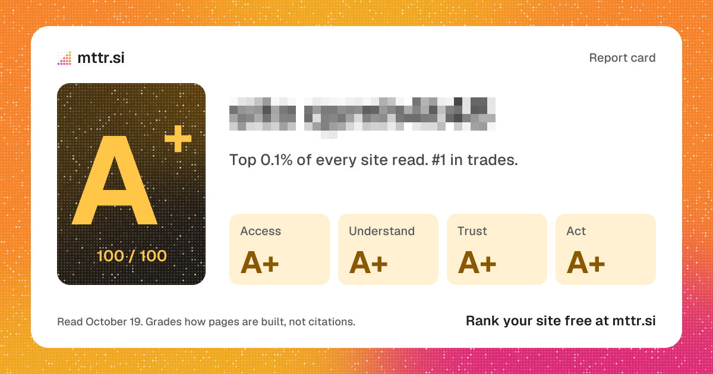

<p align="center"></p>

<p align="center">
<a href="https://agentskills.io/specification"></a>
<a href="#the-skills"></a>
<a href="https://mttr.si/agents"></a>
<a href="LICENSE"></a>
</p>

> **Moved to [subinternal/clickd](https://github.com/subinternal/clickd).** mttr is now clickd. This repository is archived: it still installs, but new versions of the skills are only there. Install them with `npx skills add subinternal/clickd`, or in Claude Code with `/plugin install clickd --marketplace subinternal/clickd`. The MCP tools keep their names, so nothing you've connected breaks.

<p align="center"><b>Agent skills that read your site the way search engines and AI assistants do,<br>fix it in your own code, and read it again to prove what moved.</b></p>

<p align="center"><a href="https://mttr.si">mttr.si</a> &nbsp;&nbsp; <a href="https://mttr.si/leaderboard">Leaderboard</a> &nbsp;&nbsp; <a href="https://mttr.si/tools">Free tools</a> &nbsp;&nbsp; <a href="https://mttr.si/docs/reference">API and MCP</a></p>

## Quick start

**1. Add the skills** from the top of your site's repository:

```sh
npx skills add subinternal/mttr
```

**2. Tell your agent:**

```text
Check yoursite.com with mttr and fix what's worth the most.
```

In Claude Code you can add them as a plugin instead, with mttr's MCP server wired in:

```text
/plugin install mttr --marketplace subinternal/mttr
```

That's it. The skills work from mttr's free public reports with nothing else to set up. [Connect over MCP](#connect-your-agent-optional-free) later if you want the full brief and a re-read on demand.

## Why

Your site has two audiences now: people, and the machines that answer for them. Google still crawls it. ChatGPT, Gemini, Claude and Perplexity read it too, and then decide whether to quote you or someone else.

Most sites are quietly failing the second audience. From the latest read of each of the 224,721 sites mttr had ranked by October 2026, 13.4 million pages:

| | |
|---|---|
| **90%** | of articles don't answer their first question right under it |
| **80%** | of sites have no `llms.txt` |
| **56%** | of pages have a description the wrong length |
| **47%** | of pages have images with nothing to describe them |
| **1 in 10** | home, service and article pages show their words only after a script runs, and most AI crawlers never run it |

Those are the ones you can count. The rest are harder to see: a `robots.txt` that blocks GPTBot without anyone meaning to, pages that bury the answer under three paragraphs of welcome. These skills give your agent the eyes to see all of it, and the order to fix it in.

## How a run goes

```
   read ───────► rank ───────► fix ───────► read again
   your site     every fix     in your      and see
   like an AI    by what it    own code     what moved
   reads it      is worth      (you approve)
       ▲                                        │
       └────────────────────────────────────────┘
```

mttr does the reading and the grading. Your agent does the fixing, in your repository, with the access it already has. Then mttr reads the live site again, and only a page that passes counts as fixed. No one grades their own homework.

## You say, it does

| You say | What happens |
|---|---|
| *"Check example.com with mttr and fix what's worth the most."* | Reads the site, ranks every fix by worth, makes the top ones in your code, reads it again. |
| *"Why isn't ChatGPT mentioning us?"* | Shows your site the way an agent gets it: what it can read, what it has to cut away, what it never sees. |
| *"Get our product pages ready for Google Shopping."* | Fixes the Product structured data in your templates, field by field, checked on the live pages. |
| *"Add an llms.txt."* | Builds one from your own pages, with tests so it never goes stale. |
| *"Get our drain repair page onto page one."* | Runs a campaign on one page for one search, through five gates, each opened only by proof. |
| *"Make this demo playable inside a post on X."* | Gives the route a player card and checks what X's crawler is really served. |

## The skills

| Skill | What it does | Version |
|---|---|---|
| **[mttr](skills/mttr)** | **Start here.** Checks your site and fixes it, worth the most first. | `1.2.1` |
| [Shop ready](skills/mttr-shop-ready) | Gets your product pages read right by Google's merchant listings, field by field. | `1.2.0` |
| [Page system](skills/mttr-page-system) | Builds your page templates so every page reads well for search and assistants. | `1.3.1` |
| [llms.txt](skills/mttr-llms-txt) | Writes a `/llms.txt` from your own pages, with tests so it never goes stale. | `1.1.2` |
| [Livecards](skills/mttr-livecards) | Makes a page run inside a post on X: a demo, a tool or a short landing page. | `1.2.0` |
| [Rank a page](skills/mttr-rank-a-page) | Moves one page up for one search, step by step, with proof at each one. | `1.2.1` |

Each skill is a folder in the open [Agent Skills](https://agentskills.io/specification) format: a `SKILL.md`, the references it links, and its own changelog. Each is also on [mttr.si/skills](https://mttr.si/skills), file by file.

## Install

### One line

```sh
npx skills add subinternal/mttr
```

### Or ask Claude Code to do it

```text
Install the mttr skills: copy every folder under skills/ in https://github.com/subinternal/mttr into ~/.claude/skills/, then tell me which skills you installed and suggest checking my site with the mttr skill.
```

### Or by hand

Copy a skill's folder to where your agent loads skills from:

| Agent | Folder |
|---|---|
| Claude Code | `.claude/skills/` in the repo, or `~/.claude/skills/` for every project |
| Codex | `.agents/skills/` in the repo, or `~/.agents/skills/` |
| Cursor | `.cursor/skills/` or `.agents/skills/` in the repo, or `~/.cursor/skills/`. It also reads `.claude/skills/`. |
| Anything else | Save the folder in the repo and add a line to `AGENTS.md` pointing at its `SKILL.md`. |

## Connect your agent (optional, free)

Connected over MCP, your agent gets the full brief for a site, its history, the next page worth writing, and a re-read whenever it asks for one. Get a free key at [mttr.si/agents](https://mttr.si/agents), then in Claude Code:

```sh
claude mcp add --transport http mttr https://mttr.si/mcp \
  --header "Authorization: Bearer $MTTR_KEY"
```

Cursor, VS Code, Codex and the rest are on [mttr.si/agents](https://mttr.si/agents#connect).

## What you won't get

- **Promises.** A score from mttr says a site's pages are well formed for crawlers and assistants. It doesn't say an assistant will cite the site, and none of these skills promises rankings or citations. Assistants change their answers day to day; anyone who guarantees you a spot in ChatGPT is selling something.
- **A bot loose on your site.** mttr reads public pages only, under its own name, and obeys `robots.txt`. Your agent makes every change in your own code, and you approve each one or review the pull request.
- **Busywork.** Fixes come in order of what they're worth, so the first hour does the most good.

## See it first

<p align="center"></p>

- **[Read your own site](https://mttr.si),** free, in about a minute. Every report leads to its Agent View: the site as an AI agent reads it, page by page.
- **[The leaderboard](https://mttr.si/leaderboard):** every site mttr has read, ranked, and the board for your line of work.
- **[Free tools](https://mttr.si/tools):** one page at a time, with nothing to install: [headings](https://mttr.si/h1-checker), [schema](https://mttr.si/schema-checker), [AI crawlers](https://mttr.si/ai-crawler-checker), [share cards](https://mttr.si/og-image-checker), [speed](https://mttr.si/website-speed-test) and more.

## Made by

[subinternal](https://subinternal.com). Testing the boundaries of what's possible. mttr is what we built to find out what AI assistants actually do with the web.

## License

MIT. See [LICENSE](LICENSE). Questions to contact@subinternal.com.
